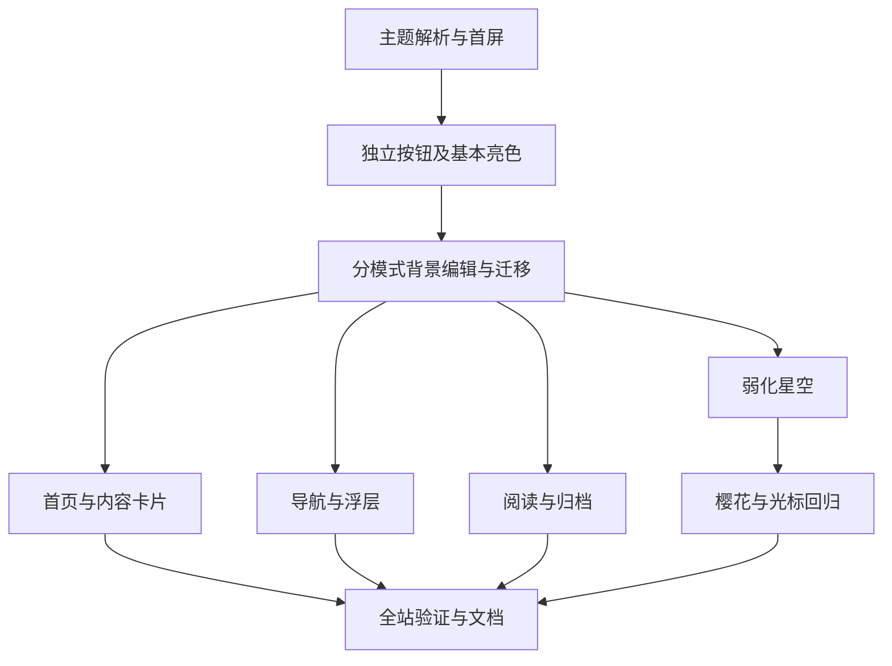

# Implementation Plan：粉白亮色模式与右上角主题按钮

状态：已批准（2026-10-09），已实施。依据已批准的 [规格](spec.md)，验证记录见 [todo.md](todo.md)。

## Overview

在当前玫瑰墨色博客中加入粉白亮色配色和弱化星空，以独立右上角按钮切换亮色、暗色、跟随系统。默认跟随系统，保留已有合法偏好，亮暗背景分别保存。基础整理使用提交 `4b360c9`。

## Architecture Decisions

### 1. 右上角直接切换

- 复用 `LightDarkSwitch.svelte`，在 `Navbar.astro` 的搜索与设置之间挂载，与邻近按钮保持尺寸和视觉风格一致；小屏幕同样显示。
- 采用参考站的独立图标按钮形式。点击、Enter 或 Space 按「亮色 → 暗色 → 跟随系统 → 亮色」循环，保留明确的系统模式入口。
- 亮色显示太阳、暗色显示月亮、跟随系统显示系统图标；图标表示保存的选择，不把实际渲染的暗色误认为用户选择了暗色。
- `title` 与无障碍名称说明当前及下一模式；优先复用已有 `lightMode`、`darkMode`、`systemMode` 国际化键。若需要新增文案键，拆成每组不超过五个文件的翻译任务，补齐全部语言后再验收。
- 使用原生按钮语义；取消旧组件依赖鼠标悬停和仅桌面显示的模式面板，避免手机与键盘行为不同。
- 静态页面初始图标由首屏主题标记控制，客户端接管后保持一致，避免系统模式图标在手动模式下短暂出现。

### 2. 一套主题状态及生命周期

- 保留 `theme` 存储键和现有 `LIGHT_DARK_MODE` 类型，默认值调整为 `AUTO_MODE`；校验仅接受 `light`、`dark`、`auto`。
- 主题工具区分「偏好模式」与「实际亮暗」。`<html>` 的 `.dark` 表示实际亮暗；额外主题模式标记记录当前选择，供控件与会话回退读取。
- 不占用现有 Expressive Code 的 `data-theme`，继续使用 `github-dark`。
- `Layout.astro` 的首屏内联逻辑在绘制前读取并应用主题；通过 `define:vars` 使用共用常量和默认值。内联脚本必须是普通 JavaScript，不能包含 TypeScript。
- 首屏与运行时依据相同判定矩阵处理无记录、非法值和读取失败；用行为验证防止两处逻辑漂移。启动应用主题时不把系统解析出的实际主题写成手动偏好。
- 手动操作先更新页面与会话状态，再尝试保存；存储失败仍可在当前会话切换，Swup 导航不得重新读取存储而覆盖会话状态。
- 系统偏好监听由常驻主题组件统一管理，卸载时清理，仅在当前偏好为 `auto` 时更新实际亮暗。
- 主题工具应用后派发统一的主题变化通知；背景编辑订阅该通知，同步当前实际主题的颜色和编辑值。监听不放进每次 `page:view` 执行的回调。

### 3. 背景分模式存储

- 外观存储增加版本 `execute233.appearance.v2`，结构包含共享 `hue` 和 `backgrounds.light`、`backgrounds.dark`；值继续使用现有颜色校验。
- 优先读取合法 v2 值；v2 无效或缺少字段时按字段回退。没有 v2 时，从 v1 提取合法色相及旧 `blog` 颜色，仅作为暗色背景迁移。
- 旧默认颜色沿用已有更新规则；亮色未设置时使用粉白默认值。保留 v1 数据，成功写入 v2 前不删除或覆盖旧记录。
- 数据层集中默认值、解析和迁移规则；首屏与编辑器复用该数据约定，避免背景先呈现暗色默认值后再切换。
- `--blog-background` 仍作为当前实际主题的背景输出，避免改动全部消费者；切换主题时同步 CSS 变量和颜色编辑器。
- 恢复默认只重置当前实际主题的背景及共享色相，不改变主题偏好、另一主题背景或其他设置。

### 4. 颜色与装饰适配

- `theme-tokens.css` 分别定义亮色和 `.dark` 颜色，共享字体、尺寸和圆角。普通组件继续通过现有 Tailwind 映射及 CSS 变量取色。
- 亮色采用批准的粉白、深梅、玫红、灰紫关系，沿用共享色相；卡片、边框和阴影分别调节材质，保证阅读区域实际对比度。
- 排查页面及组件中写死的白字、黑底、深色阴影和暗色叠层；按任务分组替换，不改布局和交互结构。
- 星空在亮色下保持淡而可见，阅读区更弱；若白色发光粒子被浅底吞没，使用适合浅底的粒子颜色与合成方式，保持同一 Canvas、单一绘制循环及用户参数。
- 「只看星空」暂时增强当前主题的背景显示，不修改主题偏好；暂停时切换主题也需主动重绘一帧。
- 检查樱花和光标浅底可见性；沿用已有暂停、减少动态效果与后台停止逻辑。

## Dependency Graph

## Build Order and Checkpoints

1. T1～T2：先跑通系统偏好、手动切换与最基本亮色页面，检查刷新和小屏幕按钮；同时确认可用浏览器工具。
2. T3～T4：完成旧背景兼容、独立编辑及首页卡片，核验对比度和背景恢复规则。
3. T5～T6：适配全站浮层及长文组件，核验真实搜索、目录、归档与站内跳转。
4. T7～T8：完成浅底星空及装饰回归，核验暂停重绘和减少动态效果。
5. T9：执行完整规格矩阵，更新维护说明，汇报代码检查、构建、浏览器证据和未验证项。

每个检查点出现失败先定位和修复，再继续后续任务。当前不自动创建提交或推送。

## Sequential and Independent Work

主题判定、首屏初始化和背景存储必须顺序实施。接口稳定后，卡片、浮层和阅读适配在逻辑上可独立检查，但共享主题变量的写入仍顺序进行。本次采用单代理执行，不需要并行代理或新增依赖。

## Verification

- 按任务运行针对变更文件的 Biome 格式化和只读检查；另行检查 CSS、Astro 和 Svelte 模板格式。
- `pnpm check` 为代码检查基线；调整类型声明后执行 `pnpm type-check`，既有问题须与本次引入的问题区分。
- 最终运行 `pnpm build`，通过 `pnpm preview --host 127.0.0.1` 验证生产样式及真实 Pagefind 搜索。中间检查按影响范围执行，不重复无变化的完整构建。
- 桌面 `1440×900`、手机 `390×844`；补查设置与导航断点，确认新增按钮不挤压搜索、设置、Logo 和音乐灵动岛。
- 对照规格验证三种选择、两种系统外观、旧存储、无效存储及存储失败；以实际浏览器验证刷新、直达、Swup、前进后退和系统外观动态变化。
- 最终截图、trace 和日志写入 `tmp/light-mode/`。浏览器不可用时继续独立代码工作，但明确保留浏览器验收待完成状态，不声称全量验收通过。

## Risks and Mitigations

| 风险 | 影响 | 应对 |
| --- | --- | --- |
| 首屏与客户端判定不一致 | 整页闪变、按钮状态错误 | 使用同一常量与判定矩阵，验证首次绘制和接管 |
| 旧暗色默认背景覆盖亮色 | 亮色模式仍显示暗底 | v2 分模式默认值与逐字段迁移，首屏同时适配 |
| 原生存储拒绝写入 | 手动切换失效或导航后回退 | DOM 会话状态优先，写入失败不回滚应用状态 |
| Svelte 组件未挂载前仍可交互 | 首屏按钮点击无效 | 及时加载常驻组件；接管前明确控件可用状态 |
| 浅底隐藏发光星点 | 无法满足保留星空 | 验证实际粒子材质和合成，必要时随主题重建缓存 |
| 暂停动画后换主题 | 粒子沿用旧材质 | 主题变更请求单帧重绘，不新增循环 |
| 顶栏小屏幕空间不足 | 按钮与 Logo、菜单重叠 | 在实际断点和手机视口验证，调整局部间距 |
| 仅修全局变量遗漏局部硬编码 | 白字浅底、黑底浮层 | 按卡片、浮层、阅读分组检查实际页面 |
| 浏览器工具连接失败 | 缺少视觉与交互证据 | 实施早期重新确认已有能力，最终报告待验证项 |

## Approval and Open Questions

需求已确定，无信息阻塞。用户已批准本计划及任务安排，包括单按钮三态循环、存储 v2 兼容和主题变化同步方案。
