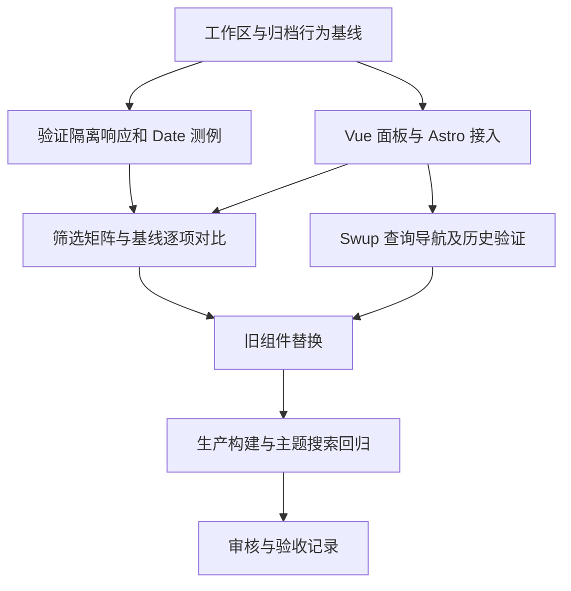

# Implementation Plan：归档组件迁移至 Vue

状态：待审核（2026-10-13）。Phase 2：Plan；依据已批准的 [spec.md](./spec.md)。模块 id：`vue-archive-panel`。

按用户 2026-10-13 的要求，本模块保留 spec.md 和 plan.md，跳过独立任务拆分，不创建 todo.md。本轮完成技术计划；计划确认后直接按方案实施，实际结果记录在本文件末尾及任务临时目录。

## Overview（概述）

创建 `ArchivePanel.vue` 替换当前 Svelte 归档面板，复用 Astro 文章列表及 URL、国际化接口，以 Vue 派生状态实现既有筛选和年份分组。保持客户端渲染、内容模型、排序和模板样式，复用主题模块建立的 Vue 集成与检查。

## Architecture Decisions（技术决策）

### 1. 数据边界与日期传递

- `archive.astro` 继续调用 `getSortedPostsList()`，只传递 `slug` 和 `data`；Vue 组件以类型导入复用 `PostForList`，不在客户端调用文章查询。
- 使用 `<script setup lang="ts">`，将 `sortedPosts` 定义为类型明确的 props，缺省采用空数组；不修改 props，也不在筛选中重排原始列表。
- 保留 `published: Date`，继续调用 `getFullYear()`、`getMonth()` 和 `getDate()`。不自行改成 ISO 字符串、添加日期解析分支或改变时区语义。
- Astro 5 官方支持向客户端框架组件传递 Date，安装包的 `serializeProps()` 也使用专用 Date 标记和 ISO 值。实际传递与显示需在生产预览验证，依据见 [Astro 5 框架组件文档](https://v5.docs.astro.build/en/guides/framework-components/#passing-props-to-framework-components)。
- 草稿过滤、博客／学习范围及输入顺序继续由现有内容工具负责，不复制到 Vue。

### 2. 用派生状态保持筛选语义

- 用一个响应式查询字符串保存当前 `location.search`，只在客户端挂载后读取；从它派生标签、分类和未分类参数。
- 依次应用标签、分类及未分类条件，然后按年份组织派生列表；多个同类参数是 OR，不同条件组是 AND。
- 保留精确字符串比较、分类存在性判断、重复参数与空参数，不增加 trim、大小写折叠或布尔转换。
- `uncategorized` 使用第一个参数值的既有非空判断，包括字符串 `false`、`0`；空值不启用未分类条件。
- 年份分组可以使用类型明确的 Map，按年份降序生成数组；每组文章按输入顺序追加，不另作年份内部排序。
- 组件只消费已经校验的文章列表。查询字符串只用于匹配，不作为 HTML 输出或动态执行内容。

### 3. 保留页面与模板接入方式

- `src/pages/archive.astro` 改为 import `ArchivePanel.vue`，使用 `client:only="vue"`，保留原文章数据和页面标题。
- Vue 模板沿用当前卡片、年份标题、计数、时间线、日期、标题和标签列的顺序及样式类，用 `v-for` 和稳定的年份／slug key 表示列表。
- 计数复用既有国际化键；链接复用 `getPostUrlBySlug()`；日期及 `#标签` 格式复用现有显示规则。
- 空结果只渲染原空卡片，不新增文案或筛选控件。正文、首屏主题、常驻 Navbar、音乐与背景不进入归档组件。
- 保留 main、`#toc` 及其他布局容器；基本接入和导航检查通过后再删除旧 `ArchivePanel.svelte`。
- 搜索仍使用 Svelte，因此本模块不调整 Svelte 集成、依赖或锁文件；不修改前序主题模块文件。

### 4. 先利用组件挂载处理导航

- 归档面板位于 Swup 的 main 替换容器中，优先在 `onMounted` 读取当前 URL，并依靠内容替换后的新组件挂载重建筛选。
- 不预先添加全局 popstate、history 包装或 Swup hook；避免为一个页面建立第二套路由状态。
- 现有 `@swup/astro` 将 `content:replace` 桥接到 `astro:after-swap`，并将 `page:view` 桥接到 `astro:page-load`，这些是定位导航生命周期的现有依据。
- 尽早验证同路径不同查询、从分类／标签进入归档、缓存恢复及前进后退。若实测某路径保留组件却改变 URL，先记录复现，再仅补充必要的 `astro:page-load` 查询同步，并在卸载时移除同一回调。
- 不为 hash 变化重建列表，不引入新路由库。Swup hook 的时序参考 [Swup 官方 Hooks 文档](https://swup.js.org/hooks/)，本项目实际行为仍以安装包与浏览器证据为准。

### 5. 在隔离测试响应中提供边界数据

- 真实生产列表的迁移前／后结果需比较完整的标题、URL、年份、计数和日期，不能只断言非空。
- 空列表及当前内容缺少的未分类组合通过 Playwright 拦截归档 HTML 响应提供；不改 `src/content/posts/`，不创建生产测试路由，也不修改 `dist/` 文件。
- 测试层使用当前 Astro 安装包的 `serializeProps()` 生成包含 Date 的测试 props，保留与真实框架相同的序列化协议。
- 在独立辅助页面用 DOMParser 解析响应 HTML，只修改明确匹配 ArchivePanel 的 `astro-island` props 属性，再通过 `route.fulfill()` 返回该测试响应。要求目标岛唯一，其他 HTML、主题及脚本保持原样。
- 在当前 Svelte 基线上先验证相同响应注入方式，再用于 Vue，避免把测试协议错误误判成框架迁移问题。
- 测试数据包含跨年份记录、相同日期记录、博客／学习文章、不同标签、空标签、空分类、null 分类及未提供分类；日期使用明确值，基线和 Vue 使用相同浏览器时区。
- Astro 内部序列化接口只用于测试辅助层；若实际安装版本路径或结构不同，先核对源码并修正辅助层，不能为测试修改生产组件。
- 正式验证脚本进入 `scripts/tests/archive-panel.playwright.mjs`，临时 fixture、runner、日志及产物进入 `tmp/vue-archive-panel/`；复用已有 Playwright，不新增框架或运行时依赖。

## Dependency Graph（依赖图）



日期协议与导航生命周期优先验证，模板与派生筛选作为一条可检查的完整用户路径迁移。主题模块已提供检查基础，本模块不依赖搜索迁移。

## Implementation Flow（实施与验证流程）

1. **记录基线。** 核查当前 Git 状态，保留已暂存的主题模块和 color-setting 改动；记录当前归档的真实生产列表、筛选 URL 结果、桌面／手机截图，以及 Astro、Vue、TypeScript 检查基线。
2. **验证边界测例入口。** 在现有 Svelte 面板上确认隔离 HTML 响应注入、日期、空列表及未分类测例；保存结果用于 Vue 对比。
3. **迁移完整归档路径。** 创建 Vue 面板、调整 Astro 接入，复用类型、链接与翻译。旧归档组件暂时保留为未引用的源码基线；先针对改动检查格式和类型。
4. **检查点：筛选与导航。** 比较真实列表和 fixture 矩阵，核查日期及年份顺序；验证同路径查询与前进后退，不以每次完整刷新替代 Swup。失败先定位派生状态、序列化或组件生命周期，再作最小修复。
5. **完成旧组件替换。** 清除旧 ArchivePanel 文件与引用，保留搜索的 Svelte 构建链，执行生产构建和最终归档矩阵。
6. **检查点：兼容与审核。** 对照规格验证布局、主题、搜索、常驻音乐状态和 `#toc`；审查代码与证据，记录未验证项，关闭本次服务与浏览器。

以上仅描述方案的实施顺序与验证节点，不另拆任务清单。正式代码范围集中在 ArchivePanel.vue、archive.astro、旧归档组件的替换及归档验证脚本；实施和验收结果直接补充至本计划。

## Verification（验证方式）

后续实施在仓库根目录使用 PowerShell 7，先格式化实际改动文件并只读检查，再运行应用及浏览器：

```powershell
pnpm exec biome format --write src/components/ArchivePanel.vue src/pages/archive.astro scripts/tests/archive-panel.playwright.mjs
pnpm exec biome ci src/components/ArchivePanel.vue src/pages/archive.astro scripts/tests/archive-panel.playwright.mjs
node --check scripts/tests/archive-panel.playwright.mjs
pnpm check
pnpm check:vue
pnpm type-check
pnpm build
pnpm preview --host 127.0.0.1
git diff --check
```

模板排版另行核验。浏览器 runner 使用环境提供的 Playwright API，具体入口在本计划的实施记录中说明；不假定 `pnpm exec playwright` 可运行。

- 筛选矩阵覆盖规格全部规则，比较精确的文章集合与显示值；重复、空值、中文编码及大小写有单独结果。
- 当前数据验证生产草稿排除及博客／学习范围；fixture 验证边界筛选、分组和 Date 显示，不将客户端 fixture 当成内容构建验证。
- 桌面 `1440×900`、手机 `390×844`、`767/768px`，两种主题下检查时间线、标签列、截断、焦点及文章链接。
- 从实际分类／标签链接站内跳转，并覆盖同路径不同查询、前进后退和至少 10 次进入／退出归档；确认页面没有整页刷新、重复列表、旧筛选残留或监听累积。
- 连续导航后检查主题选择、音乐实例和播放状态；真实 Pagefind 搜索使用构建预览，不能使用开发假结果。
- 记录 pageerror、控制台错误及本地失败请求；截图、报告和可用 trace 显式保存至 `tmp/vue-archive-panel/playwright/`。
- TypeScript 声明基线按诊断位置和内容比较，前序模块记录的 10 项错误仅作参考，以当前实施前结果为准。未新增错误不等于原声明检查全量通过。
- 实际改动稳定后执行适当的最终检查；只在新修改、失败或未解决问题出现时扩大或重复验证。

## Risks and Mitigations（风险与应对）

| 风险 | 影响 | 应对 |
| --- | --- | --- |
| Date 被测试层转成普通字符串 | 年份或日期异常 | 用 Astro 原序列化协议，在 Svelte 基线上先验证，再比对 Vue |
| 新框架改变筛选习惯 | 旧链接返回不同集合 | 保留精确匹配和参数非空语义，以矩阵逐项比较 |
| Vue 重新排序原始数组 | 年内顺序变化 | 不修改 props，仅在新分组集合中排列年份 |
| 查询变更未触发重新挂载 | 残留旧筛选 | 尽早复现同路径和历史导航，必要时用单一现有生命周期通知同步 |
| 测试 HTML 匹配错目标岛 | 误改主题或测例无效 | 唯一定位 ArchivePanel，只替换其 props，辅助层验证后使用 |
| 空结果没有可等待的文章链接 | 测试误超时 | 等待归档岛挂载和 Vue 更新完成，单独核查空卡片 |
| 仅检查非空掩盖日期与计数错误 | 错误验收 | 比较标题、URL、年份、计数、日期和标签的完整基线 |
| 删除 Svelte 集成过早 | 搜索失效 | 本模块只移除旧归档组件，保留依赖并做真实搜索回归 |
| 用户继续暂存或修改文件 | 覆盖前序工作 | 实施前重新核查状态，按明确归档文件范围修改 |

## Sequential and Independent Work（顺序与协调）

采用单代理顺序执行；正式内容数据和接口不需要重构。fixture 验证与 Vue 组件在逻辑上可分开检查，但本次不使用并行代理，不与后续搜索模块同时修改共享文件。

## Open Questions（待解决事项）

需求无阻塞问题，待审核本计划。实际 Swup 同路径查询的挂载行为、隔离响应注入和日期恢复将在实施阶段验证；当前只检查了源码与官方资料，未运行归档迁移浏览器测试。

计划确认后直接进入实现与验证，不增加任务拆分阶段或 todo.md。本轮按用户要求只完成计划。
