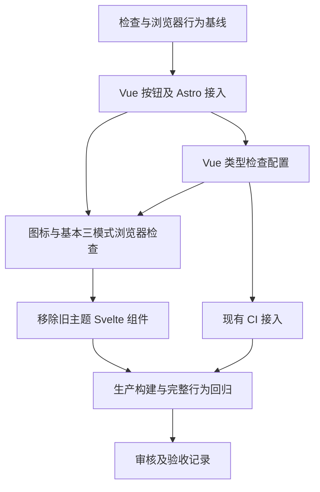

# Implementation Plan：主题切换组件迁移至 Vue

状态：已批准、已实施（2026-10-12）。依据已批准的 [spec.md](./spec.md)，任务及验证记录见 [todo.md](./todo.md)。模块 id：`vue-theme-switch`。

本计划保留批准的技术选择、依赖顺序及验证节点；已完成组件、类型检查和 CI 接入，实施校正与实际结果见末尾及 todo.md。

## Overview（概述）

以 Vue 单文件组件替换导航栏的主题切换按钮，保留现有三模式循环、首屏主题初始化、偏好与会话存储、图标和布局。现有主题工具继续作为页面主题的接口，Vue 管理按钮状态和监听生命周期。

## Architecture Decisions（技术决策）

### 1. 用一个 Vue 组件完成主题入口迁移

- 创建 `src/components/LightDarkSwitch.vue`，使用 `<script setup lang="ts">`、`ref`、`computed`、`onMounted` 和 `onUnmounted`。
- 将当前模式和接管状态分别保存为组件状态，下一模式与国际化标签使用派生值；循环复用 `LIGHT_MODE`、`DARK_MODE`、`AUTO_MODE`。
- 初始化状态与服务端输出保持确定，按钮在接管前禁用。挂载后调用 `getStoredTheme()` 同步首屏确定的会话选择，再启用按钮；挂载不以默认状态重写页面主题。
- 用户操作更新模式并调用现有 `setTheme()`；不创建 Vue Router、Pinia、全局主题 store 或新的持久化格式。
- 保留按钮 ID、模式属性、图标容器类名、按钮样式类及无障碍标签。三模式的视觉显示继续遵循根元素 `data-theme-mode` 的现有 CSS。

### 2. Astro 负责组件接入与图标

- `Navbar.astro` 将主题组件 import 改为 `.vue`，继续使用 `client:load`。
- Vue 模板通过 `<slot name="light" />`、`<slot name="dark" />`、`<slot name="auto" />` 接收 Navbar 已有 Astro Icon 内容；不在 Vue 内 import `.astro`。
- 保持搜索、导航菜单、设置面板及导航同步脚本的既有职责，避免因主题迁移扩大 Navbar 改动。
- 接入验证通过后删除旧 `LightDarkSwitch.svelte`，确认仓库中该文件的引用均已更新。搜索和归档仍需要 Svelte，因此保留 `svelte()` 和相关依赖。
- Astro 具名插槽的接入依据见 [Astro 框架组件文档](https://docs.astro.build/en/guides/framework-components/#passing-children-to-framework-components)。实际输出和激活仍需构建及浏览器验证。

### 3. 保留现有主题接口，清晰管理监听

| 接口或事件 | Vue 组件中的用途 |
| --- | --- |
| `getStoredTheme()` | 挂载和同步时读取 DOM 优先的当前会话模式 |
| `setTheme(mode)` | 用户操作时应用主题并尝试保存 |
| `applyThemeToDocument(mode)` | 跟随系统时更新页面实际外观 |
| `THEME_CHANGE_EVENT` | 同步按钮状态，不反向写存储或再次应用主题 |
| 系统 `prefers-color-scheme` 变化 | 当前会话模式为 `auto` 时触发实际主题更新 |

- 所有浏览器对象只在挂载后的逻辑中使用。模块导入和服务端 setup 不读取 DOM、存储或系统偏好。
- 挂载时注册一组系统监听和主题通知监听；卸载时用同一回调引用移除。常驻 Navbar 在 Swup 页面跳转时无需重新注册监听。
- 主题通知仅重新读取模式，不调用 `setTheme()` 或 `applyThemeToDocument()`，避免事件递归和额外存储写入。
- 系统监听不保存解析后的亮暗值；手动模式忽略系统变化。存储失败继续由现有工具处理，页面 DOM 维持会话状态。
- 首屏脚本、背景、星空和音乐无需新增初始化流程。若验证发现确由本迁移引入的接口问题，仅作满足规格所需的最小修复，并记录原因。

### 4. 增加独立 Vue 类型检查

- 新增开发依赖 `vue-tsc`，计划固定为 `3.3.13`。2026-10-12 通过 `pnpm view vue-tsc version engines peerDependencies --json` 查询所得版本为 `3.3.13`，其 TypeScript peer 范围为 `>=5.0.0`，包含当前声明版本 `^5.9.3`。依赖范围相符不代替实际运行验证。
- 安装命令为 `pnpm add -D -E vue-tsc@3.3.13`，同步更新 `package.json` 与 `pnpm-lock.yaml`；不批量更新其他依赖。该命令用于后续实施，本轮未执行。
- 新增根目录 `tsconfig.vue.json`，继承当前 `tsconfig.json` 的严格模式、路径别名及 Astro 环境；设 `noEmit: true`、`declaration: false`，启用 `vueCompilerOptions.strictTemplates`。
- 检查入口覆盖 `src/**/*.vue` 和 `src/**/*.d.ts`；排除 `node_modules`、`dist`、`tmp`。Vue 导入的 TypeScript 依赖仍由编译器检查，不通过排除或宽泛类型绕开组件错误。
- 增加脚本 `"check:vue": "vue-tsc --noEmit -p tsconfig.vue.json"`。`pnpm check` 继续检查 Astro，原 `pnpm type-check` 继续用于 TypeScript 声明基线。
- 在 `.github/workflows/build.yml` 现有 check job 的 Astro 检查之后追加 `pnpm check:vue`；沿用现有 Node 22、23 矩阵、安装方式和其他工作流。
- 先由 Astro 同步生成 `.astro` 类型，再执行 Vue 检查。实际接入出现工具配置不兼容时先定位原因，不静默降级模板检查。
- Vue 官方推荐使用 `vue-tsc` 检查单文件组件，依据见 [Vue TypeScript 文档](https://vuejs.org/guide/typescript/overview#overview)。

### 5. 使用已有浏览器能力验证

- 当前会话工具列表提供 Playwright 浏览器工具；历史 `tmp/light-mode/scripts/` 也保存了使用已有 Playwright 运行时与无头 Edge 的脚本。实施时确认连接与运行时可用性，当前未启动浏览器。
- 优先使用 Playwright 工具；需要早期初始化脚本、存储故障注入或监听计数时，使用其可用的 Playwright API，或已有本地运行时。
- 可复用的主题行为验证脚本放在 `scripts/tests/theme-switch.playwright.mjs`，采用接收已有 Page 和产物目录的方式；不新增测试框架，避免依赖机器绝对路径。
- 临时 runner、检查日志和浏览器产物放在 `tmp/vue-theme-switch/`。历史 light-mode 脚本和产物只作为参考，不能覆盖或清理。

## Dependency Graph（依赖图）



类型配置以真实 Vue 组件作为检查入口，避免无 Vue 文件时把检查误记为通过。系统监听和存储边界依赖于现有主题工具，不依赖其他两个迁移模块。

## Build Order and Checkpoints（顺序与检查点）

1. **记录基线：** 保留用户已暂存的 `color-setting.ts` 及其他未提交文件；运行当前 Astro、TypeScript 检查，记录类型错误的具体诊断；通过现有组件取得主题、图标与导航行为基线。需要生产基线时运行现有构建，不使用历史截图替代。
2. **完成按钮接入：** 创建 Vue 组件并调整 Navbar，旧主题组件暂时保留为未引用的比对基线。先检查模板格式与静态诊断，再验证具名插槽和实际按钮。
3. **建立类型检查与 CI 接入：** 安装固定版本工具，加入独立配置与检查脚本，再追加现有 check job 的 Vue 检查。Astro 与 Vue 检查同时保持可运行。
4. **检查点：基础能力。** 三模式循环、接管后模式、系统外观变化、三个图标与基本存储正常；Astro 检查和 Vue 检查通过，原 TypeScript 检查没有新增问题。若插槽、激活或生命周期失败，先修复再继续。
5. **完成旧组件替换及完整回归：** 清除旧主题组件和引用，运行生产构建与规格矩阵；保留搜索、归档的 Svelte 构建链。
6. **检查点：验收。** 全部验收标准有对应证据或明确未验证记录；审核实际改动范围、类型基线、控制台错误和失败请求。完成后更新本模块文档，不自动提交、推送或部署。

这是计划级顺序；具体文件分组、任务验收清单和每项执行状态记录在 `todo.md` 中。

## Verification Commands（验证命令）

后续实施在仓库根目录使用 PowerShell 7。先针对实际变更文件格式化并执行只读检查，再运行应用或浏览器；Vue、Astro 模板和工作流缩进另行核验。

```powershell
pnpm exec biome format --write src/components/LightDarkSwitch.vue src/components/Navbar.astro package.json tsconfig.vue.json
pnpm exec biome ci src/components/LightDarkSwitch.vue src/components/Navbar.astro package.json tsconfig.vue.json
pnpm check
pnpm check:vue
pnpm type-check
pnpm build
pnpm preview --host 127.0.0.1
git diff --check
```

`pnpm check:vue` 为本计划新增命令，安装和配置完成前不可视为已有命令。调试开发页面时使用 `pnpm dev --host 127.0.0.1`；复用合适的已有服务，以启动输出的实际端口为准。

Vue 检查配置可用前如需生成 Astro 类型，使用 `pnpm exec astro sync`。CI 的 `pnpm astro check` 会先执行 Astro 检查流程，Vue 检查随后执行。

已有 TypeScript 错误按诊断位置与错误内容比较，不能仅比较错误数量，也不能关闭声明检查掩盖问题。历史记录中的 10 项错误只是线索，本次以实施前实际输出为准。

## Browser Verification（浏览器验证）

- 使用隔离浏览器上下文，准备独立测试存储；不覆盖用户日常浏览器设置或系统剪贴板。
- 通过 Page 的初始化脚本设置旧偏好、非法值和存储拒绝读写条件；检查接管前按钮禁用、首屏主题与接管后选择一致。
- 在生产预览执行 `light`、`dark`、`auto` 与系统亮暗组合；核对根元素、按钮 `data-mode`、可访问名称、图标、存储值和系统变化后的实际主题。
- 验证刷新、代表性页面直达、Swup 跳转和前进后退；禁用存储时特别核查导航保留会话选择，完整刷新遵循既有回退。
- 通过早期监听记录或可用的运行时观察，核查组件负责的系统及主题事件监听。至少 10 次站内跳转后数量不增长；每次点击只推进一个模式，卸载释放对应监听。
- 桌面 `1440×900`、手机 `390×844`，补查 `767/768px`、`800/801px`；验证 Tab、Enter、Space、焦点及导航栏布局。
- 覆盖首页、博客、学习、归档、关于、工具、代表性代码文章；自定义亮暗背景、色相、星空暂停和减少动态效果完成兼容检查。
- 音乐状态回归核查现有音频实例、曲目、播放位置、音量与暂停状态；浏览器允许时验证实际播放中切换，受媒体能力限制的部分单独记录。
- 搜索在构建预览使用真实 Pagefind 结果；归档检查分类与标签；新增 Vue 入口不影响仍使用 Svelte 的两个组件。
- 用元素状态、URL 和事件等待页面就绪；记录控制台错误、失败请求、截图及可用 trace，产物显式指向 `tmp/vue-theme-switch/playwright/`。

## Risks and Mitigations（风险与应对）

| 风险 | 影响 | 应对 |
| --- | --- | --- |
| Astro 图标具名内容在 Vue 中输出不同 | 图标缺失或布局变化 | 尽早检查实际 SSR 输出与接管后 DOM，沿用原图标容器及根元素 CSS |
| 初始 Vue 状态覆盖首屏选择 | 主题闪变、旧偏好丢失 | 挂载先读取现有会话，不默认应用 auto；保持接管前禁用 |
| 主题通知触发再次应用主题 | 重复事件或递归 | 通知仅同步读取，用户操作与系统变化才调用应用接口 |
| Swup 导航重复初始化监听 | 多次切换或后台监听累积 | 常驻组件挂载注册、卸载清理；导航循环后记录监听数量 |
| Vue 检查继承声明生成配置 | 误报或漏查模板 | 独立配置启用严格模板检查、关闭声明生成，保留 Astro 与原声明检查 |
| 本地 Node 24 与 CI Node 22、23 不同 | 本地通过但 CI 失败 | 保留 CI 矩阵，使用满足 TypeScript peer 范围的固定工具版本；未运行的矩阵不声称通过 |
| Biome 对模板覆盖不足 | 排版与模板错误漏检 | 人工核验模板，配合 Vue 类型检查、构建和浏览器验证 |
| 存储失败下导航回退 | 会话偏好丢失 | 沿用 DOM 优先读取及先应用后保存，生产预览故障注入验证 |
| 旧组件删除时误清理 Svelte 依赖 | 搜索与归档失效 | 本模块仅删除旧主题组件；构建与联合回归检查其他入口 |

## Sequential and Independent Work（顺序与协调）

采用单代理顺序执行。Navbar 的主题接入与后续搜索迁移共享文件，本模块完成后再处理搜索。类型工具配置、组件生命周期及最终证据属于本模块，不引入跨模块新接口。

静态输出检查和浏览器场景在代码稳定后可分别核验；依赖安装、配置修改、服务启动与组件替换按顺序执行。未来任务拆分保持每个任务约 5 个以内正式文件，并能独立验证。

## Open Questions（待解决事项）

实施校正（2026-10-12）：原 `@astrojs/vue 7.0.2` 的 peer 要求 Astro `^7.0.0`，与本站 Astro `5.13.10` 不匹配。通过包注册表核对，改为固定 `@astrojs/vue 5.1.4`，其 peer 为 Astro `^5.0.0`、Vue `^3.2.30`，保持本站主框架版本与迁移范围。新增 Vue 检查配置使用官方 `dataAttributes: ["data-*"]` 识别合法 HTML 数据属性，保留 `strictTemplates: true`；不关闭其他属性或模板检查。

需求无阻塞问题，本计划的技术选择已确认并实施。vue-tsc 的实际检查、生产构建及 24 组浏览器场景通过；使用已有本地 Playwright 与 Edge，远程 CI Node 矩阵尚未执行。

本模块实现及自审完成，检查证据和限制记录在 todo.md；未自动提交、推送或部署。
